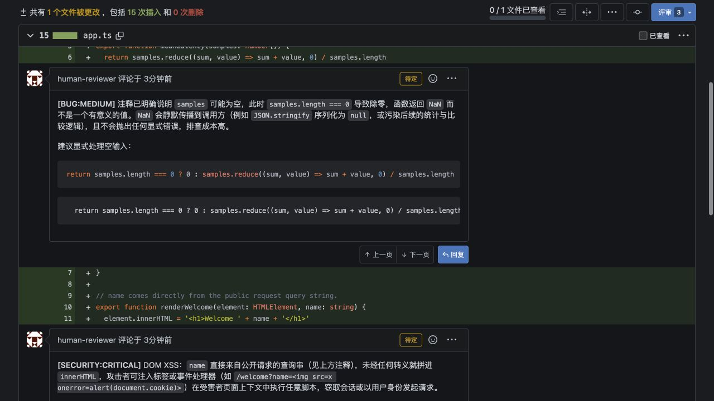
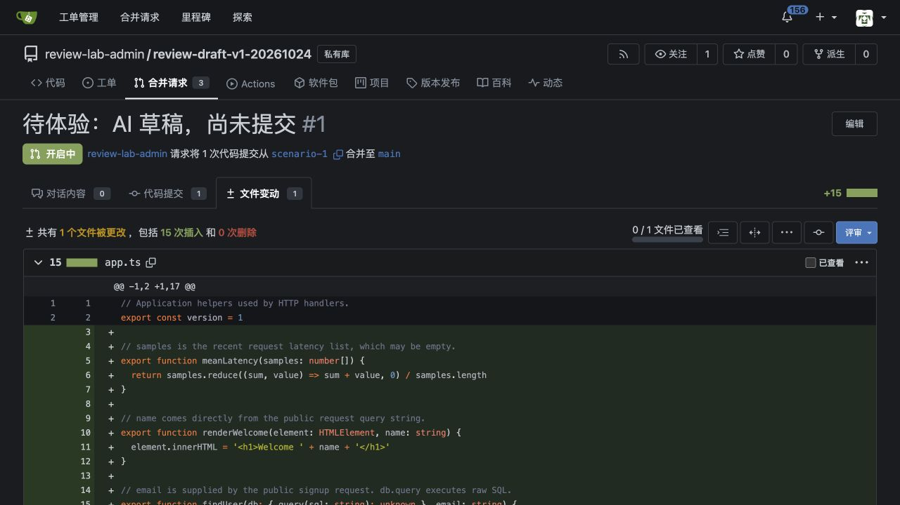
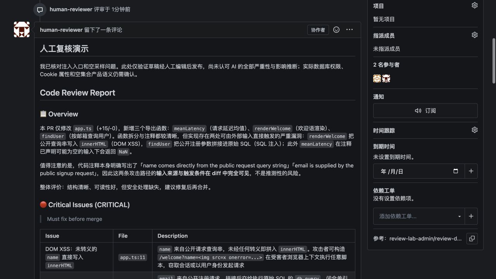

# Draft review walkthrough and validation

This is the local acceptance record for the implementation proposed in
[issue #27](https://github.com/ccsert/opencode-review-gitea/issues/27), recorded
on 2026-10-24. See [the usage guide](draft-review.md) for Docker commands,
custom model configuration and recovery instructions.

## What the reviewer sees

The demo used a private test repository with three identical PR diffs. An
external Docker invocation selected the repository and PR; the target
repository had no review workflow or OpenCode installation. The token belonged
to the ordinary `human-reviewer` account, so that is the account shown on the
pending comments and on the eventual submitted review.

### 1. Pending comments under the reviewer's account

The real model produced findings about empty latency samples, HTML injection
and SQL injection. The native UI labels its line comments as pending (the yellow
“待定” badges in this Chinese-language test instance). The reviewer can edit
them using the comment menu. No Approve/Request Changes decision is published
by the draft run, even when the model recommends one.

### 2. Another ordinary collaborator sees the code, without the pending findings

The same PR opened as `review-bot`, a separate ordinary collaborator, shows the
diff without the other account's pending line comments. On both tested servers,
the pending review detail/comments endpoints returned 404 for this account,
and its review list excluded the pending review. The timeline API was checked
separately because its privacy behavior differs; see the compatibility notes.

### 3. The reviewer edits the summary and submits through the native UI

The reviewer copies the local Markdown summary into the review form and edits
it before selecting Comment, Approve or Request Changes. This example was
submitted as Comment after adding a human qualification of the model's impact
claims. The separate collaborator can then read the submitted review.

The screenshots show test data. The UI language and report text are independent
of draft mode; set `REVIEW_LANGUAGE=en` for an English model response. This flow
does not prefill the native summary form.

## Validation scope

The local runtime used OpenCode 1.19.4 with Gitea 1.24.6 and Forgejo 17.0.0.
The runtime code was commit `154c9d143afc4a11ec24c0704b4d0cd1a51b68cf`;
the subsequent documentation/screenshots do not change that runtime.

| Layer | Observed result |
|---|---|
| Unit tests | 140 passed, 0 failed; 335 assertions |
| Real Gitea/Forgejo API integration tests | 48 passed, 0 failed; 250 assertions |
| Type checking and shell syntax | Passed |
| Docker → real OpenCode → deterministic model protocol fixture → production tools | Submit and draft modes passed on both servers, including large-diff pagination and untrusted project-config isolation. This layer does not measure model quality. |
| Docker → real OpenAI-compatible provider → MiniMax M3.1 Flash | One complete model run per server generated pending comments and a verified draft receipt. The provider's gateway model ID was `auto/MiniMax-M3.1-Flash`. |
| Repeated invocation after container exit | Reused the same pending review ID from the persisted output/state directory |
| Pending comment edited in the native UI | A new invocation stopped with `DRAFT_EDITED`; the human edit remained intact |
| Review submitted in the native UI | A new invocation returned `draft_submitted`; no extra review was created |
| Two-account access | Pending review details and comments were unavailable to the other ordinary account; submitted reviews were visible |
| Timeline access | No AI summary or pending line-comment body appeared in the other account's timeline response |

Each server's second and third PRs reused that server's first real AI analysis
through the production review modules to compare lifecycle states. They were
not four additional model-inference runs. Browser validation covered editing
and submitting on both platforms, plus signing in as the other Gitea account
to check visibility before and after submission.

The local image reused an already validated OpenCode 1.19.4 runtime and copied
in the production branch code. A fresh local Dockerfile build was cancelled
when upstream dependency resolution stalled. This local acceptance record
does not certify a clean release build, remote CI or a published image; check
the PR's own workflow results for those statuses.

## Compatibility and interpretation

- AI summaries remain in the persisted local output. The tested servers can
  expose a PENDING review's body through the timeline API, so the server receives
  only a non-sensitive handoff placeholder and an opaque marker in that field.
- Gitea 1.24.6 supports removing this run's exact placeholder timeline entry.
  After manual submission, the test had one native timeline review entry.
- Forgejo 17.0.0 retains review-type timeline entries despite returning 204 to
  the deletion request. The run reports `PENDING_TIMELINE_RETAINED`; manual
  submission can display the same review twice. The review ID remains the same,
  and the placeholder contains no AI summary.
- These checks concern ordinary collaborators, not site administrators.
  Server versions may differ. Draft mode stores a real pending review and can
  have metadata/notification side effects; it is not an offline dry run.
- The model's severity and impact claims still need human judgment. For example,
  database permissions, Cookie attributes and the expected empty-sample behavior
  are not established by the small demo diff. The human edits in the examples
  illustrate why the handoff step matters.

For repeatable automated checks, see [local testing](local-testing.md).

### PR review follow-up

The PR's automated review identified a timeline URL bug when an owner or
repository is named `pulls`. The issue was reproduced with two focused tests
that failed before the fix. Timeline lookup and deletion now share the exact
repository path, and both cases verify draft creation, receipt generation,
placeholder cleanup and reuse of the same review. The updated unit suite has
142 passing tests; the original 140-test record above describes the initial
UI acceptance runtime.

The first Linux CI run passed the clean Dockerfile build and both submit-mode
protocol checks, then exposed a test-harness ownership assumption: the host
runner could not read a root-owned 0600 draft export. The smoke check now reads
the export in a container with the same identity, keeping the private file
mode. The usage guide documents this Linux bind-mount behavior as well.

Scoped-token checks on both servers confirmed that `write:repository` alone
cannot read `/user`, and adding `read:user` still cannot read the issue timeline.
The usage guide lists the required draft scopes: `read:user`, `write:repository`
and `write:issue`. A complete production-module draft run with those three
scopes succeeded on each server; the temporary validation tokens were revoked
afterward.
